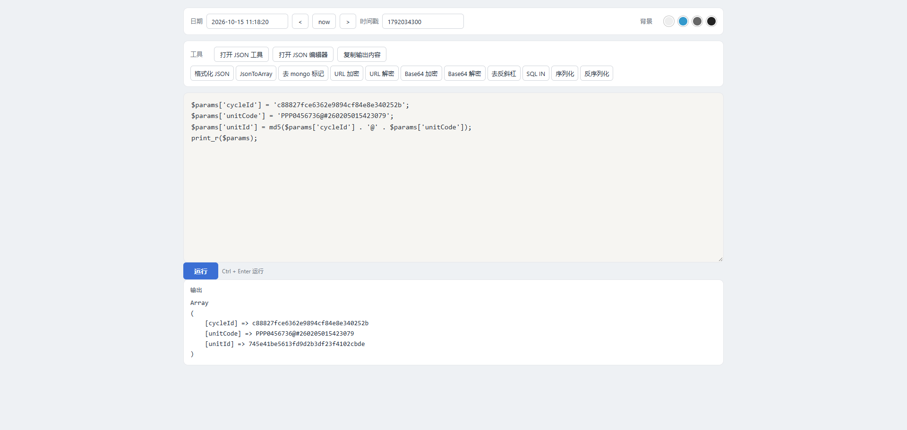
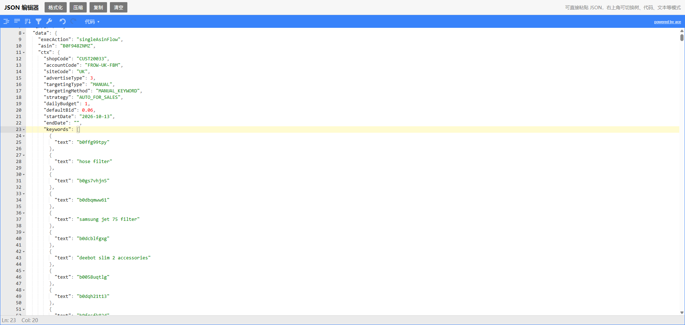

# tool.cc

本地 PHP 开发小工具。在浏览器里执行 PHP 片段，并处理 JSON、URL、Base64、时间戳和 Mongo 数据。JSON 相关页面下载后可离线打开。

## 使用

把本目录设为站点根目录，域名指向 `tool.cc`，然后打开 [http://tool.cc](http://tool.cc)。

`do.php` 会直接执行提交的 PHP 代码，只适合本机使用。

## 功能

### PHP 执行

在编辑区输入 PHP 代码（可省略 `<?php`），点击「运行」或按 `Ctrl + Enter`。结果出现在下方「输出」里，可一键复制。

### 文本处理

对编辑区内容使用工具栏：

| 按钮 | 作用 |
| --- | --- |
| 格式化 JSON | 解析后重新输出 JSON |
| JsonToArray | 转成 PHP 数组（`var_export`） |
| 去 mongo 标记 | 把 `NumberInt("1")`、`ObjectId("...")` 转成普通值 |
| URL 加密 / 解密 | `urlencode` / `urldecode` |
| Base64 加密 / 解密 | `base64_encode` / `base64_decode` |
| 去反斜杠 | `stripslashes` |
| SQL IN | 把逗号、空格或换行分隔的值拼成 `"a","b"` |
| 序列化 / 反序列化 | `serialize` / `unserialize` |

### 时间

顶部可在日期（`YYYY-MM-DD HH:mm:ss`）和时间戳（秒或毫秒）之间互转。`now` 填入当前时间。

### 其它页面

- [JSON 工具](jsonTool/json.html)：JSON / XML 解析、格式化、校验
- [JSON 编辑器](jsoneditor/index.html)：格式化、压缩、复制，可切换树、代码、文本等模式

右上角可切换背景色，选择会记在浏览器本地。

## 界面

### 主页面

### JSON 编辑器

